# Kestrel Clipper — the complete guide

Everything the app does, in the order you'll meet it. If you just want to be running in ten minutes, use the
[quick setup](SETUP.md) instead and come back here when you want to understand a setting.

**Contents**

1. [What it actually does](#1-what-it-actually-does)
2. [Installing it (and the blue warning)](#2-installing-it-and-the-blue-warning)
3. [The dashboard, page by page](#3-the-dashboard-page-by-page)
4. [Setting up the AI](#4-setting-up-the-ai) — *which model, what it costs, what each one can't do*
5. [Adding a streamer](#5-adding-a-streamer)
6. [Letting it run: the auto clipper](#6-letting-it-run-the-auto-clipper)
7. [Clip now: grabbing a moment yourself](#7-clip-now-grabbing-a-moment-yourself)
8. [The VOD analyser](#8-the-vod-analyser)
9. [Review: judging what it found](#9-review-judging-what-it-found)
10. [Edit style: how your clips look](#10-edit-style-how-your-clips-look)
11. [Editing a single clip](#11-editing-a-single-clip)
12. [Publishing](#12-publishing)
13. [Campaigns](#13-campaigns)
14. [Trends](#14-trends)
15. [Telegram approvals](#15-telegram-approvals)
16. [Reel ideas and B-roll](#16-reel-ideas-and-b-roll)
17. [Every setting, explained](#17-every-setting-explained)
18. [Licence, trial and updates](#18-licence-trial-and-updates)

---

## 1. What it actually does

Kestrel Clipper runs on **your** PC. It is not a website and nothing is uploaded to us.

While a streamer you follow is live, it keeps a rolling recording of the last ten minutes. It watches two things
at once: how hard chat is reacting, and — if you've given it an AI key — what is actually happening on screen.
When something looks worth posting, it cuts a clip out of that buffer, edits it into a vertical short with
captions, scores it out of 100, and drops it in **Review**.

What it needs:

| | |
| --- | --- |
| **Windows** | 10 or 11, 64-bit |
| **Disk** | ~10 GB free. More if you follow several streamers at once |
| **Internet** | It downloads the live stream in real time — roughly 3–6 GB per hour, per streamer |
| **The PC awake** | It cannot record while the machine is asleep |
| **An AI key** | Optional, but it is the difference between "chat got loud here" and "he rammed a police car into a canal". See [section 4](#4-setting-up-the-ai) |

It does **not** need a graphics card, but it uses one if you have an NVIDIA card, and editing is several times
faster with it.

---

## 2. Installing it (and the blue warning)

Download **Kestrel.Clipper.Setup.exe** from the
[releases page](https://github.com/xRedxDevilx/kestrel-clipper-releases/releases/latest). It's about 171 MB.

### The blue "Windows protected your PC" box

Windows shows this for any program it hasn't seen downloaded many thousands of times yet. **It is not a virus
warning** and it does not mean anything was found in the file. The certificate that would quiet it costs several
hundred pounds a year *and* still shows the warning until enough people have downloaded the file, so small
independent apps all get it.

1. Click the small **More info** link.
2. The box grows and a **Run anyway** button appears. Click that.

**Only do this for a file from the releases page linked above.** If you got the installer anywhere else, delete
it. To check your copy is genuine, the release page lists an SHA-256 checksum — run this in PowerShell and the
value should match exactly:

```powershell
Get-FileHash "$HOME\Downloads\Kestrel.Clipper.Setup.exe"
```

### Installer options

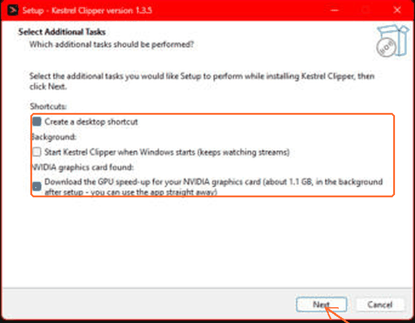

| Option | What it does |
| --- | --- |
| **Create a desktop shortcut** | Leave on unless you don't want the icon. |
| **Start Kestrel Clipper when Windows starts** | Worth turning **on** — it can only catch a stream if it's running when that stream goes live. |
| **Download the GPU speed-up** | Only appears with an NVIDIA card. About **1.1 GB**, downloaded in the background after setup. Makes editing many times faster. Leave on unless short on data or disk. |

Then **Install**, wait a minute or two while it unpacks ~500 MB, and **Finish** with **Open Kestrel Clipper now**
ticked.

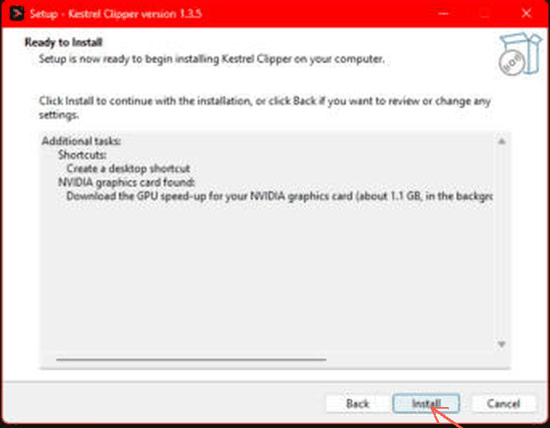
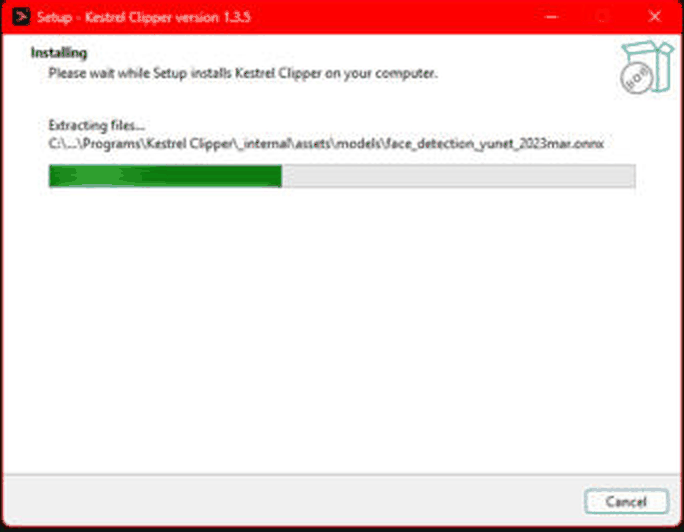
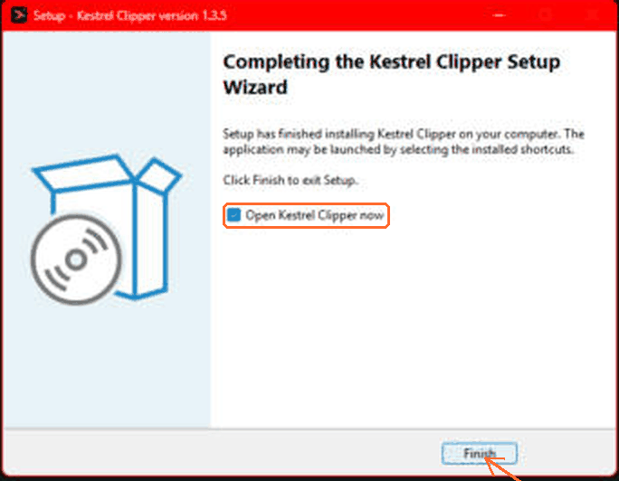

The first start takes a few seconds — it's starting its engine before it shows anything.

### Installing over a running copy

You don't have to close it first. The installer stops the running app, replaces it, and starts it again. If
Windows ever complains it can't close the app, quit it from the tray icon and run the installer again.

---

## 3. The dashboard, page by page

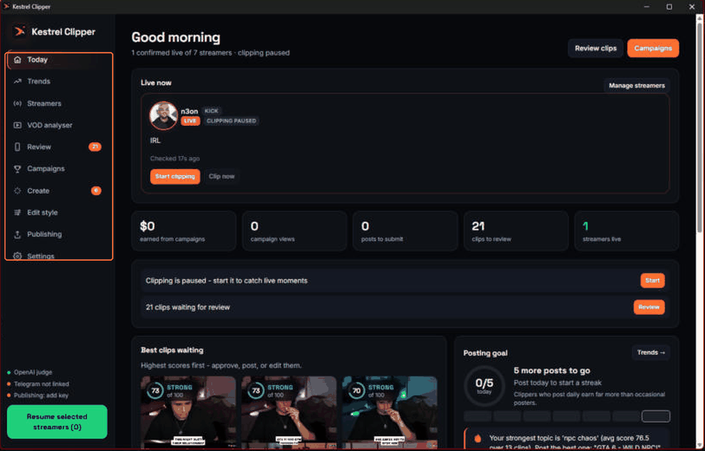

The menu down the left is the whole app:

| Page | What it's for |
| --- | --- |
| **Today** | What's live now, what's waiting for you, and how you're doing against your posting goal |
| **Trends** | What's actually working on your own channel — topics, lengths, posting times |
| **Streamers** | Who you follow, and the per-streamer settings |
| **VOD analyser** | Point it at a past broadcast or a YouTube video and it finds the moments |
| **Review** | Every clip it found, with its score and reason. This is where you'll spend your time |
| **Campaigns** | Paid clipping campaigns — rules, links and earnings |
| **Create** | Reel ideas it collected while watching, and B-roll it saved |
| **Edit style** | How every clip is cut, captioned and branded |
| **Publishing** | Where clips go, and the accounts they go to |
| **Settings** | Everything else |

### Closing it doesn't close it

This catches everyone. Closing the window leaves the app **running in the system tray** so it doesn't miss a
stream going live. The kestrel icon lives bottom-right near the clock, possibly behind the **^** arrow — click it
to bring the window back, right-click it and choose **Quit** to actually stop.

If you'd rather the X quit everything, turn on **Quit when I close the window** in **Settings**.

### It can't record while the PC is asleep

If you want overnight streams, set Windows to never sleep while plugged in:
**Settings → System → Power → Screen and sleep → When plugged in, put my device to sleep after → Never**.

---

## 4. Setting up the AI

**Settings → AI judge.**

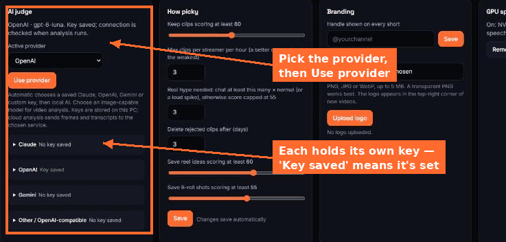

Without a key, the app still works — it scores on how hard chat reacted and how loud the stream got. That catches
loud moments but can't tell a clutch play from someone shouting at a loading screen. With a key, it actually
looks at the footage.

### Getting a key

| Provider | Where | Notes |
| --- | --- | --- |
| **Claude** | [console.anthropic.com](https://console.anthropic.com) → API keys | The default. Best at describing what's on screen |
| **OpenAI** | [platform.openai.com](https://platform.openai.com/api-keys) | Fine. Use a vision-capable model |
| **Gemini** | [aistudio.google.com](https://aistudio.google.com/app/apikey) | Has a free tier, with daily limits |
| **Other / OpenAI-compatible** | Anything speaking the OpenAI API — OpenRouter, Together, a local server | You supply the base URL |
| **Local (Ollama)** | Nothing to pay | Needs a decent GPU. Noticeably worse at this job |

Paste the key, pick a model, click **Save**. The app stores keys encrypted on your own machine and never sends
them anywhere except that provider.

> **These keys are money.** Anyone with your key can spend on your account. Don't paste one into Discord asking
> for help, and if you ever do, revoke it from the provider's console immediately.

### Set a spend limit before you set anything else

Every provider lets you cap what an API key can spend per month. **Do this first.** A misconfigured app that
clips 400 moments a day on an expensive model is the only way this costs you real money, and a $20 cap turns
that disaster into a quiet failure.

- Anthropic: Console → Settings → Limits
- OpenAI: Platform → Settings → Limits → monthly budget

### What each moment actually costs

A judged moment sends about **ten frames at 768px plus the transcript** — roughly 6,900 tokens in and 400 out.
The numbers below are that arithmetic at list prices, checked November 2026. Prices move; the pricing pages are
the truth.

| Model | Per judged moment | 1 streamer, ~48/day | 5 streamers, ~240/day |
| --- | --- | --- | --- |
| **Claude Haiku 5.5** | $0.0009 | **~£1/month** | ~£5/month |
| Claude Sonnet 5.5 | $0.018 | ~£20/month | ~£101/month |
| Claude Opus 5.5 | $0.036 | ~£40/month | ~£202/month |
| **GPT-6 Luna** | $0.0009 | **~£1/month** | ~£5/month |
| GPT-6.1 Terra | $0.009 | ~£10/month | ~£51/month |
| GPT-6.1 Sol | $0.018 | ~£20/month | ~£101/month |

Two things follow from that table:

- **The model is the whole bill.** Nothing else you change comes close. A cheap model on five streamers costs
  less than an expensive one on half a streamer.
- **Watch the right-hand column.** The cost scales with how many *moments* get judged, not how long you leave it
  running. Five streamers is five times the bill.

### Which model to actually pick

**Start on Haiku 5.5 (or GPT-6 Luna).** Run it for a week. At around £1/month it costs less than being wrong
about it, and for "did something happen here, and is it clear without context" it is close to the expensive
models. Move up only if you look through **Review → AI skipped** and find good moments sitting in there.

Move up to **Sonnet 5.5 / GPT-6.1 Sol** if your content needs reading rather than watching — podcasts,
reactions, anything where the point is in what someone *said*. The cheap models miss sarcasm and the end of a
long argument.

**Opus 5.5 is not worth it here.** It's built for long reasoning; this job is one short judgement about 90
seconds of footage. You are paying 40× Haiku for a verdict that is rarely different.

### What the models can't do

Worth knowing before you blame the app:

- **It only sees ten still frames**, not video. Something that only reads as funny in motion — a physics glitch,
  a badly-timed dodge — can score low because the frames look ordinary.
- **It can't hear.** It reads a transcript. Tone, a scream, a sarcastic delivery, music — all invisible unless the
  words carry it. (Loudness is measured separately and feeds the score.)
- **It doesn't know what happened ten minutes ago.** By design: a clip that needs earlier context is a bad clip.
  But it means a long-running bit will be judged on its punchline alone.
- **It can't read a game it's never seen.** It describes what's on screen. For an obscure game it'll be vague.
- **Local models are much worse at this.** They tend to describe rather than judge, and they approve things no
  one would watch. Use one for privacy or zero cost, not for quality.

### The watch model

**Edit style → Live AI watch** is a second pass that looks at every live stream on a timer to spot things chat
never reacted to — chases, clutch plays, fails, big reactions, first looks. It uses the same provider as the
judge and runs far more often, so it is the other half of your bill.

| | |
| --- | --- |
| **Watch live streams** | On by default. Off halves your API spend and loses the quiet-but-great moments — a clean trickshot nobody in chat noticed |
| **Look every** | 60 seconds by default. Longer means cheaper and more missed |
| **Flag at score** | 60. How interesting a look has to be before the full judge is woken up. Raise it if the judge is being asked about too much nothing |

Two free-text boxes sit underneath and are worth filling in, because they're what makes the judge score for
*your* channel rather than a generic one:

- **Channel niche** — what your channel is about (`GTA 6`, `Fortnite`, `IRL`). It is a preference, not a filter:
  every stream is still judged on the game it's actually playing.
- **What your channel posts** — leave blank and it's built from the niche. It also learns from every clip you
  approve, reject or clip by hand.

### Transcription is free

Speech-to-text (Whisper) runs **on your PC**, not through the API — it costs nothing per clip.
The quality setting trades speed for accuracy: `small` is the default and right for most people, `medium` is
noticeably slower and better for mumbling or heavy accents.

---

## 5. Adding a streamer

**Streamers** in the menu.

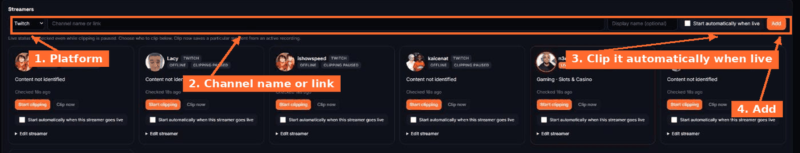

1. Pick the platform: **Twitch**, **YouTube** or **Kick**.
2. Type the channel name or paste a link. Twitch and Kick want the channel name as it appears in the URL
   (`twitch.tv/`**`shroud`** → `shroud`). YouTube takes a handle (`@mrbeast`), a channel URL, or a channel ID.
3. **Display name** is optional — it only changes what you see in the app and in clip credits.
4. **Start automatically when live** ticks the common case: you want this channel clipped whenever it's on.
5. **Add**.

The card goes grey with "Checked just now" until that channel goes live. **Nothing appears while nobody is
live, and that is normal** — most of running this app is waiting.

### Picking streamers that are actually worth clipping

The app can only clip what's there. What works:

- **Live chat that reacts.** A stream with 30 viewers gives the chat detector nothing to work with. The AI watch
  still covers you, but you're running on one engine instead of two.
- **Something visual.** Gaming, IRL and reactions clip far better than a podcast, because the payoff is on
  screen rather than in minute nine of an argument.
- **Check their rules.** Most streamers are happy to be clipped with credit; some aren't, and a few have
  explicit policies. The app credits the source on every clip by default — leave that on.
- **Two or three to start.** Each extra streamer is more bandwidth, more disk and more API spend, and there is no
  prize for following twenty and reviewing none.

### Per-streamer options

Click **Edit streamer** on a card.

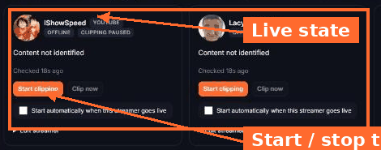

| Option | What it does |
| --- | --- |
| **Display name** | What you see, and what goes in the clip credit |
| **Credit** | The exact credit line on clips from this streamer — set it if their handle differs from their channel name |
| **Start automatically when live** | Begin clipping the moment they go live, without you being there |
| **CPM** | What a campaign pays per 1,000 views for this streamer. Only used for the earnings estimates |
| **Start clipping / Stop** | Start now, regardless of the automatic setting |
| **Clip now** | Grab the last few minutes by hand — see [section 7](#7-clip-now-grabbing-a-moment-yourself) |

### The master switch

Bottom-left, the green button — **Resume selected streamers** / **Pause** — stops and starts everything at once
without touching individual streamers. Use it when you want the PC back.

---

## 6. Letting it run: the auto clipper

Once a streamer is live and clipping, this is what happens, in order:

1. **It records.** A rolling buffer of the last 10 minutes, in 10-second chunks. Older chunks are thrown away.
   Nothing is kept unless a clip is made from it.
2. **It learns what normal looks like.** For the first two minutes it measures the chat rate and the loudness so
   it knows what a spike actually is. Nothing is clipped during this warm-up — if a channel goes live and the
   first 120 seconds are dead, that's why.
3. **Two detectors run.**
   - **Chat spike** — messages suddenly arriving far faster than normal, weighted so that `KEKW`, `clip it`, `no
     way`, 💀 and the rest count for more.
   - **AI watch** — every 60 seconds the AI looks at the last 75 seconds of footage, transcript and chat, and
     flags anything exciting. This is what catches great moments in a quiet chat.
4. **The judge decides.** Anything either detector flags gets the full treatment: frames from around the moment,
   the transcript and a chat sample go to the AI, which answers with a verdict, a score out of 100, a title, a
   caption, hashtags, and exactly where the clip should start and end.
5. **It edits.** Vertical crop, captions burned in, hook card, zoom punches, your branding — all per
   [Edit style](#10-edit-style-how-your-clips-look).
6. **It lands in Review**, or posts itself if you've set that up.

### The knobs that matter

| Setting | Default | What happens if you change it |
| --- | --- | --- |
| **How picky** (`min_virality`) | **60** | The score a clip must reach to be kept. Below it, the clip is deleted. Too little coming through? Drop to ~55. Too much rubbish? Raise to ~70 |
| **Clips per hour, per streamer** | 3 | A cap, not a target. A better clip replaces the weakest one in the hour rather than adding to it |
| **Chat must be this much above normal** | 3× | Raise it and only real explosions count. Lower it and quiet chats start producing clips |
| **AI watch** | On | Off halves your API bill and loses the moments chat slept through |
| **Only judge streams whose game contains…** | blank | Type `Grand Theft Auto` and it ignores that streamer's other games entirely |
| **Moments to include** | blank | Free text that steers the judge: *police chases, rage, funny NPCs*. Not a filter — a nudge |

### Why nothing is happening

In rough order of likelihood:

- **Nobody is live.** Check **Today → Live now**.
- **It's the first two minutes.** Warm-up.
- **Your picky score is too high.** Open **Review → AI skipped** and read what it threw away. If good stuff is
  sitting in there, that's your answer.
- **It's a quiet stream with AI watch off.** Turn AI watch on.
- **The game filter is set** to something that stream isn't playing.

---

## 7. Clip now: grabbing a moment yourself

Something just happened and you don't want to wait for the detectors to agree.

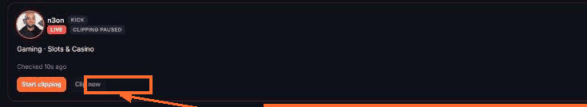

Press **Clip now** on a live streamer's card. It takes what's in the buffer right now — the last few minutes —
sends it through the same judge and editor, and puts the result in Review.

Two things that are different about manual clips:

- **They are never auto-deleted**, whatever they score. You asked for this one, so the janitor leaves it alone.
- **You're limited by the buffer.** It can only cut from the last 10 minutes. If the moment was twenty minutes
  ago it's gone — use the [VOD analyser](#8-the-vod-analyser) on the recording instead.

---

## 8. The VOD analyser

**VOD analyser** finds the moments in something that has already happened: a past Twitch broadcast, a YouTube
video, a local file.

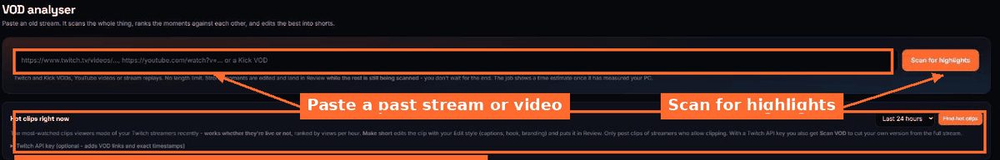

Paste a URL and press **Scan for highlights**. It downloads, scans the whole thing for likely moments, ranks
them against each other, then fully judges and edits the best. There's no length limit.

You don't have to wait for the end — **strong moments are edited and land in Review while the rest is still
being scanned**, and the job shows a time estimate once it has measured your PC.

| Option | What it does |
| --- | --- |
| **Moments to edit** | How many of the best moments get fully judged and cut. Default 12. This is the main cost control — a 6-hour VOD has hundreds of candidates and you don't want all of them |
| **Maximum hours** | Stop after this much of the video. 0 = the whole thing |
| **Story clips** | Joins 2–4 related moments into one short that tells a complete story — setup through payoff. Usually worth leaving on |

A long VOD takes a while and works the disk hard. It's the right tool for a streamer who's offline right now, or
a big event you missed.

### Hot clips

Below the URL box, **Hot clips right now** does something different and often better: it finds the clips
*viewers themselves* made of your streamers recently, ranked by views per hour. It works whether or not the
streamer is live. **Make short** takes one of those and edits it with your own Edit style — captions, hook,
branding — and drops it in Review.

This is the shortcut when you're starting out. Someone else already did the work of spotting the moment, and the
view count is evidence it lands. **Only post clips of streamers who allow clipping.**

A free [Twitch API key](https://dev.twitch.tv/console) is optional and adds VOD links and exact timestamps, which
in turn unlocks **Scan VOD** — cutting your own version from the full stream instead of using the viewer's clip.

---

## 9. Review: judging what it found

This is where you'll spend your time.

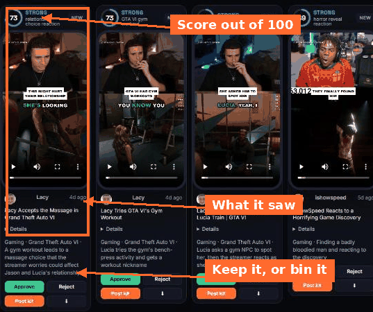

Each clip shows the video, a **score out of 100**, and the reason the AI gave. The ring around the score is
colour-coded so you can triage without reading: the higher the number, the more confident the judge is that a
stranger would watch it to the end.

| Score | What it means |
| --- | --- |
| **85+** | Post it. This is what auto-publish uses by default |
| **70–84** | Good. Worth a look before posting |
| **60–69** | Borderline — kept, but check it |
| **Below your picky score** | Deleted automatically, unless you made it with Clip now or approved it |

### The buttons

| | |
| --- | --- |
| **Approve** | Keep it. If publishing is set to "when I approve", this also posts it |
| **Reject** | Bin it. Deleted after a few days (**Settings → Delete rejected after**) |
| **Edit** | Open it in the clip editor — see [section 11](#11-editing-a-single-clip) |
| **Post & submit** | Gives you the file plus the title, caption and hashtags ready to paste |
| **Download** | Just the file |

### Flags

Some clips arrive flagged. A flag never means "bad clip" — it means **don't let this one post itself without a
human looking**, so flagged clips are held out of auto-publish:

| Flag | Why |
| --- | --- |
| **spoiler** | The title or hook gives away a story beat. Reword it and the flag stops mattering |
| **early_violence** | Graphic violence in the first 7 seconds. YouTube pulls ads from Shorts that open that way — start the clip slightly later |
| **gambling** | Slots, casino, betting. Platforms restrict these and most campaigns ban them outright |
| **music** | Recognisable copyrighted music is audible. Expect it to be muted or claimed |

### AI skipped

The **AI skipped** tab is the most useful diagnostic in the app. It shows what was thrown away and why. Read it
once a week:

- Good moments in there → your **picky** score is too high, or your model is too weak.
- Endless "nothing clearly happens" → that's the app working. Most of a stream genuinely isn't clippable.

---

## 10. Edit style: how your clips look

**Edit style** decides how every clip is cut, captioned and branded. Change it once and everything after it
follows.

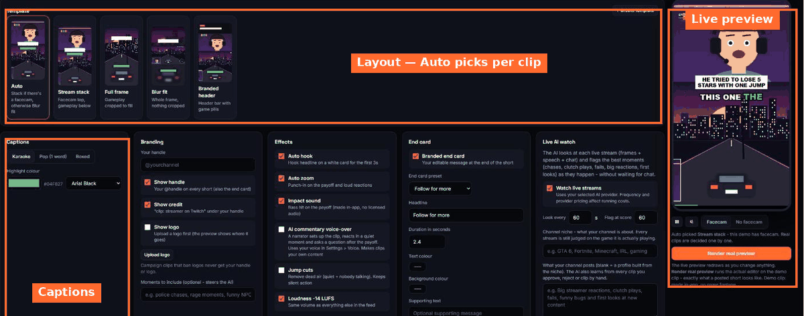

### Layout

| Template | Use it when |
| --- | --- |
| **Auto** | Default. Looks for a facecam and picks Stream stack if it finds one, Blur fit if it doesn't |
| **Stream stack** | Facecam on top, gameplay below. The standard gaming short |
| **Full frame** | Gameplay cropped to fill 9:16. Best when the action is centred — you lose the edges |
| **Blur fit** | The whole 16:9 frame, blurred bars top and bottom. Use when losing the edges would lose the joke |
| **Branded header** | A header bar with game pills above the clip |
| **+ Create template** | Your own layout — drag the regions where you want them |

The panel on the right shows a live preview as you change things, and **Render real preview** runs your actual
settings over a real clip, so you can see what a posted short will look like before you commit.

### Captions

| | |
| --- | --- |
| **Style** | **Karaoke** (words light up as spoken — best retention), **Pop (1 word)** (one word at a time), **Boxed** (subtitle block) |
| **Font** | Arial Black, Impact, or Montserrat Black if installed |
| **Highlight colour** | The karaoke highlight. Bright green is the default because it survives compression |
| **Censor swearing** | `F**K` on screen. **Leave this on** — visible swearing gets Shorts limited, and it doesn't touch the audio |

### The attention tricks

| | |
| --- | --- |
| **Auto hook** | The AI's headline on a white card over the first 3 seconds. The single biggest thing for watch time |
| **Auto zoom** | Punches in on the payoff and on loud reactions |
| **Impact sound** | A bass hit on the payoff, made in-app. No licensed audio, so nothing to claim |
| **AI commentary voice-over** | A narrator sets up the clip, reacts at the key moment, and asks a question after the payoff — in your chosen voice. See below |
| **Jump cuts** | Removes dead air (quiet, nobody talking). **Off by default on purpose** — in gameplay, silence is usually tension |
| **Loudness −14 LUFS** | Levels everything to the loudness TikTok and Shorts expect |

### Branding

| | |
| --- | --- |
| **Show handle** | Your @handle on every short, and on the end card |
| **Show credit** | "clip: *streamer* on Twitch" under it. **Leave this on.** It's the difference between clipping and taking |
| **Show logo** | Upload a PNG (up to 5 MB, transparent works best) for the top-right corner. Note that campaign clips which ban logos never get yours |
| **Moments to include** | Free text that steers the AI — *police chases, rage moments, funny NPCs*. A nudge, not a filter |
| **Branded end card** | Your message over the last couple of seconds — headline, duration, text and background colour, optional supporting line |

### Commentary (optional)

**AI commentary voice-over** (in the Effects panel) adds a narrator — a line setting the clip up, a reaction at
the key moment, a question after the payoff — spoken in the voice you picked in **Settings → Voice**. It costs
extra API calls and it changes what the clip legally is: a raw repost is someone else's content, while a clip carrying your
own commentary is original work. That's why **clips with commentary are allowed to post to YouTube** and raw
ones aren't.

---

## 11. Editing a single clip

Press **Edit** on a clip in Review.

You can move the start and end, change the title and captions, swap the layout, and re-render just that clip.
Everything here is per-clip and doesn't touch your Edit style defaults.

The source footage behind a clip is kept for **48 hours** (**Settings → Keep sources for**), so you can re-cut it
with different in and out points during that window. After that the clip is final — the original is gone and only
the rendered short remains.

---

## 12. Publishing

**Publishing.** Clips can go out by hand or on their own.

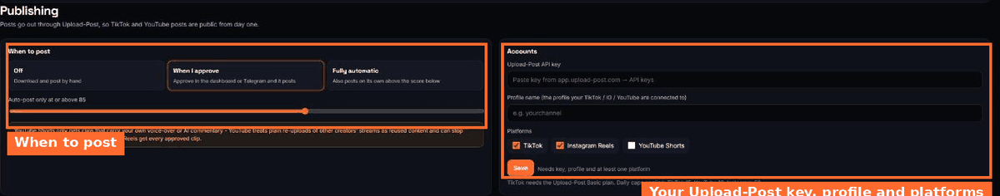

### Modes

| Mode | What it does |
| --- | --- |
| **Off** | Nothing posts. Clips wait in Review and you post them yourself. Start here |
| **When I approve** | Pressing Approve also posts it |
| **Automatic** | Also posts on its own anything scoring at or above your auto-post score (default 85), as long as it carries no flags |

### Connecting accounts

Posting goes through **Upload-Post**, one API that is already approved with TikTok, Instagram and YouTube. That
approval is the point: a brand-new TikTok developer app can only post *privately* until it's been audited, so
going direct would mean nothing you posted was public.

1. Sign up at [upload-post.com](https://upload-post.com) and connect your TikTok / Instagram / YouTube there.
2. Copy the **API key** into Kestrel, and the **profile name** your accounts are linked to — that's the profile
   name, not your email.
3. Tick the platforms.
4. **Check setup** runs through everything that can be checked without posting: key present, platforms chosen,
   captions within limits, the clip has somewhere to go, room left in today's caps.

The last line of that check always says the same thing: whether your social accounts are really linked inside
Upload-Post **cannot** be verified from here. The only honest test is to post one clip for real and read the
receipt. Do that before you rely on it.

**Instagram direct** is an alternative: connect Meta's own API and Instagram posts go straight there, bypassing
Upload-Post for that platform.

### Daily caps

Fifteen TikTok, ten YouTube, fifty Instagram per day. These are the app's own caps, set below the platforms'
limits to keep your accounts out of trouble. When one is reached, the rest wait.

### Why YouTube is treated differently

By default raw clips **don't** go to YouTube. A reposted clip of someone else's stream is exactly what YouTube's
reused-content rules demonetise. Clips carrying your own voiceover, and voiceover reels you made in the app, are
original content and do go there. You can override it, but understand what you're overriding.

---

## 13. Campaigns

**Campaigns** is for paid clipping — where a streamer or an agency pays per 1,000 views.

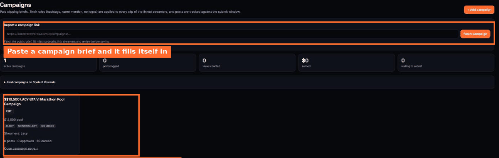

Set up a campaign with its streamer, its rate and its rules, and the app enforces the rules for you: most
campaigns demand the streamer's name in the title and a specific hashtag in every caption, and ban gambling
content. Those rules are applied automatically to every clip from that streamer, so you don't lose a payout to a
missing hashtag.

**Submissions** tracks what you've sent and what it's earned, using the CPM you set per streamer.

---

## 14. Trends

**Trends** reads your own posting history and tells you what's actually working — which topics land, what
length does best, when you post, and how your streak is going.

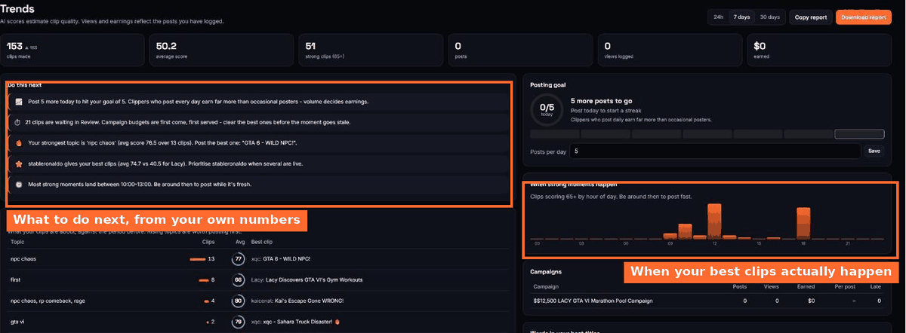

It needs **about ten posted clips** before it says anything useful; below that it will tell you so rather than
invent a pattern from three data points. Everything on it is computed from your own clips on your own PC —
nothing is fetched, and no data leaves the machine.

---

## 15. Telegram approvals

Approve clips from your phone without going near the PC.

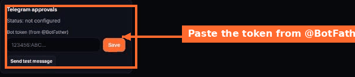

1. In Telegram, message **@BotFather**, send `/newbot`, follow the prompts, and copy the token it gives you.
2. Paste the token into **Settings → Telegram** and save.
3. The app shows a code. Message your new bot `/start CODE`.

That links your account. New clips arrive as messages with Approve / Reject buttons, and approving from Telegram
does exactly what approving in the dashboard does — including posting, if publishing is set that way.

The token is as sensitive as an API key: anyone holding it controls the bot.

---

## 16. Reel ideas and B-roll

Under **Create**:

**Reel ideas** — while it watches streams, the app notes ideas for shorts *you* could make: a tip that came up, a
question chat kept asking, a thing people got wrong. Pick one and it writes a script, speaks it with a voice, and
cuts it over B-roll. These are original content, so they can go to YouTube.

**B-roll** — clean gameplay footage with the facecam cropped out and no audio, saved automatically as it runs.
This is the footage those reels are built over. Star the good ones; the rest are deleted oldest-and-weakest-first
once the folder passes its size limit (15 GB by default).

**Voices** — **Edge** (Microsoft's online voices, free, the default) or **VoiceStudio** if you run it locally.

---

## 17. Every setting, explained

**Settings.** Most people never touch these. They're here so that when you do need one, you know what it does.

### Detection

| Setting | Default | What it does |
| --- | --- | --- |
| **How picky** | 60 | Score a clip must reach to be kept. The single most useful dial in the app |
| **Chat must be this much above normal** | 3× | How big a chat spike has to be before it counts |
| **Clips per hour, per streamer** | 3 | A cap. A better clip replaces the weakest in the hour |
| **Check for live every** | 60s | How often offline channels are checked |
| **Recording quality** | 1080p60 → best | Falls back down the list if the stream doesn't offer the top one |
| **Buffer length** | 10 min | How much of each live stream is kept on disk to cut from |
| **Before / after the moment** | 40s / 20s | The window cut around a detected moment, before the AI trims it |

### The AI

| Setting | Default | What it does |
| --- | --- | --- |
| **Provider / key / model** | Claude | See [section 4](#4-setting-up-the-ai) |
| **AI watch** | On | The 60-second look at every live stream |
| **Watch model** | Haiku 5.5 | Runs far more often than the judge — keep it cheap |
| **Watch score needed** | 60 | How interesting the watch pass must find something before the full judge looks |
| **Transcription quality** | small | tiny / base / small / medium. Runs on your PC, costs nothing |
| **Shortest / longest clip** | 30s / 180s | 180 is the YouTube Shorts maximum |
| **Only judge streams whose game contains** | blank | A hard filter on the game name |
| **Moments to include** | blank | Free text to steer the judge |

### Storage

| Setting | Default | What it does |
| --- | --- | --- |
| **Delete rejected after** | 3 days | Rejected and AI-skipped clips are removed after this |
| **Keep sources for** | 48 hours | How long a clip can still be re-cut in the editor |
| **B-roll limit** | 15 GB | Past this, the weakest un-starred shots go first |
| **Keep video of skipped clips** | Off | On costs disk but lets you see what was thrown away |

### App behaviour

| Setting | Default | What it does |
| --- | --- | --- |
| **Quit when I close the window** | Off | Off = the X leaves it clipping in the tray |
| **Daily posting goal** | 5 | What Today and Trends measure you against |
| **Video encoder** | auto | NVIDIA GPU when available, otherwise CPU |

---

## 18. Licence, trial and updates

### The trial

Kestrel Clipper comes with a **7-day free trial, no card**.

The clock starts at **your first clip**, not at install — a download that sits unopened for a month still gets its
full week. A trial that never makes a clip expires 21 days after first run, so it can't sit open for ever.

The banner at the top of the dashboard always shows where you stand, with the subscribe link in it.

When the trial ends, **nothing you have already made is touched**. Every clip stays on your PC and you can still
post it. What stops is finding *new* ones.

### After the trial

Subscribe, then paste the licence key from your order into **Settings → Licence**.

A key is tied to **one PC**. The app sends a fingerprint of the machine, not anything personal, and the first
machine to use the key claims it. Changing PCs means resetting the key from your order page or asking support.

If the licence server can't be reached, the app keeps working for **7 days** on the last good check rather than
locking you out over a wobbly connection.

### Updates

It checks once a day and tells you in the dashboard when there's a new version. **Check for updates** in
**Settings** asks right now instead of waiting.

**Download** fetches the installer, verifies its checksum, and **Install and restart** runs it. It closes the
running copy, installs over it and starts it again — your settings, streamers and clips are all kept.

### Diagnostics

**Settings → Download diagnostics** builds a zip of recent logs and your settings **with every key and token
stripped out**. That's the thing to send to support when something breaks.

---

Something not working? See [troubleshooting](TROUBLESHOOTING.md).
