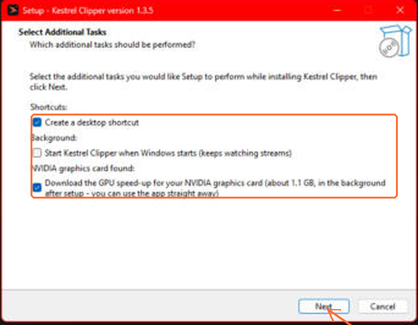
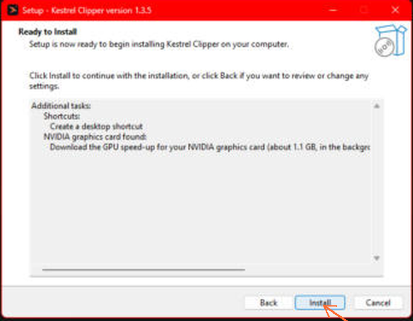
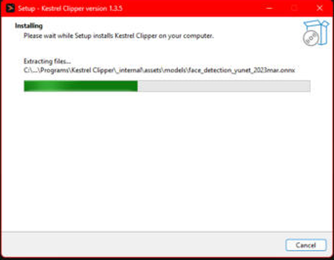
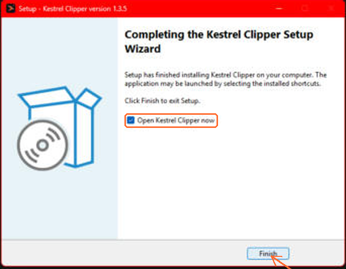
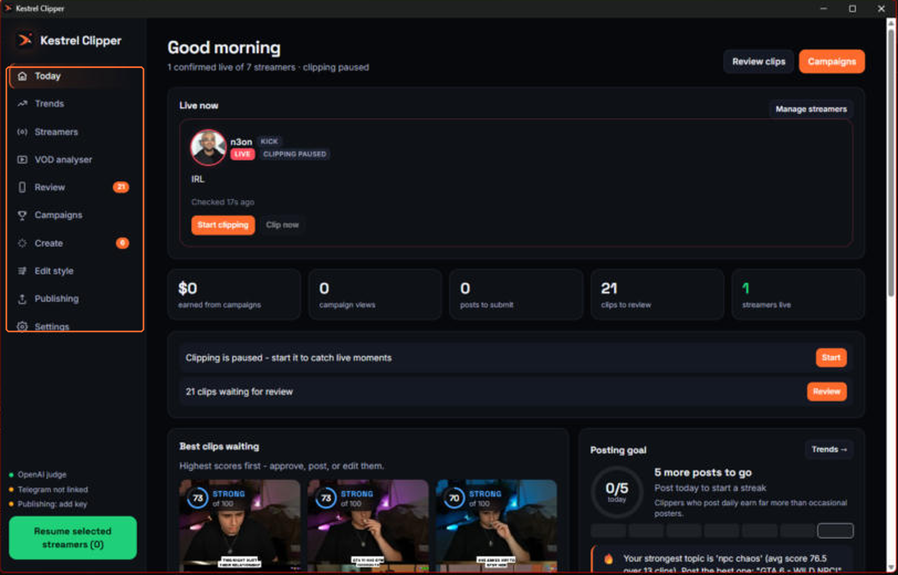

# Setting up Kestrel Clipper

From download to your first clip. About ten minutes, most of it waiting for the install.

**You need:** Windows 10 or 11 (64-bit), roughly 10 GB free, and the PC awake while a stream you follow is live.

---

## 1. Download it

Go to the [releases page](https://github.com/xRedxDevilx/kestrel-clipper-releases/releases/latest) and download
**Kestrel.Clipper.Setup.1.3.5.exe**. It's about 171 MB.

## 2. Get past the blue warning

When you run it, Windows shows a blue box: **"Windows protected your PC"** with a **Don't run** button.

**This is expected and it is not a virus warning.** Windows shows it for any program it hasn't seen downloaded
many thousands of times yet. The certificate that would silence it costs several hundred pounds a year and
*still* shows the warning until enough people have downloaded the file, so a small independent app like this one
gets the warning.

- Click the small **More info** link in the box.
- The box grows and a **Run anyway** button appears. Click that.

**Only do this for a file you downloaded from the releases page linked above.** If you got the installer anywhere
else, delete it. You can check your copy is the genuine one — the release page lists an SHA-256 checksum, and
running `Get-FileHash` on the downloaded file in PowerShell should print exactly the same value.

## 3. Choose your options

Three choices here:

| Option | What it does |
| --- | --- |
| **Create a desktop shortcut** | Leave it on unless you don't want the icon. |
| **Start Kestrel Clipper when Windows starts** | Worth turning **on** — it can only catch a stream if it's running when that stream goes live. |
| **Download the GPU speed-up** | Only appears if you have an NVIDIA card. It's about **1.1 GB**, downloaded in the background after setup, and makes editing many times faster. Leave it on unless you're short on data or disk. |

Click **Next**.

## 4. Install

Click **Install**, then wait. It unpacks about 500 MB of files, so give it a minute or two.

## 5. Open it

Leave **Open Kestrel Clipper now** ticked and click **Finish**.

The first start takes a few seconds — it's starting its engine before it shows you anything. Then the dashboard
opens in its own window.

## 6. Add a streamer and start clipping

1. Go to **Streamers** in the menu on the left.
2. Pick Twitch, YouTube or Kick, type the channel name (`xqc`, or a YouTube handle like `@mrbeast`), and add it.
3. Press **Start clipping**.

That's it. It now watches for that channel going live, records while it's live, and puts clips in **Review** as
it finds moments. Nothing appears while nobody is live — that's normal.

## 7. When clips arrive

**Review** shows each clip with a score out of 100 and a short reason. Approve the ones you want, and
**Post & submit** gives you the file plus a ready-made title, caption and hashtags to paste.

---

## Two things that confuse people

**Closing the window doesn't close the app.** That's deliberate — it keeps clipping in the background so it
doesn't miss anything, and the kestrel icon in the system tray (bottom-right, near the clock, possibly behind
the **^** arrow) brings it back. To actually quit, right-click that tray icon and choose **Quit**.

If you'd rather the window's X quit the app completely, turn on **Quit when I close the window** in **Settings**.

**It can't record while the PC is asleep.** If you want overnight streams, set Windows to never sleep while
plugged in.

---

## Getting better clips

- **Add an AI key** in **Settings → AI judge** (Claude, OpenAI or Gemini). Without one it still works, scoring on
  how hard chat reacted and how loud the stream got, but it can't understand what actually happened.
- **Settings → How picky** sets the score a clip must reach to be kept. If too little comes through, lower it to
  about 55; if there's too much rubbish, raise it.
- **Review → AI skipped** shows what it rejected and why. If good moments are sitting in there, your score is too high.

Something not working? See [troubleshooting](TROUBLESHOOTING.md).
